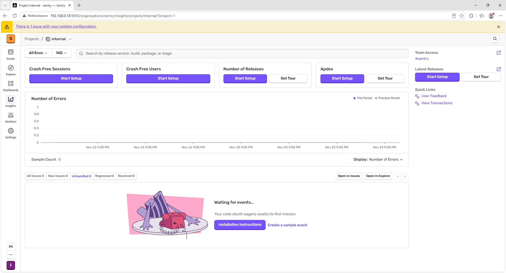
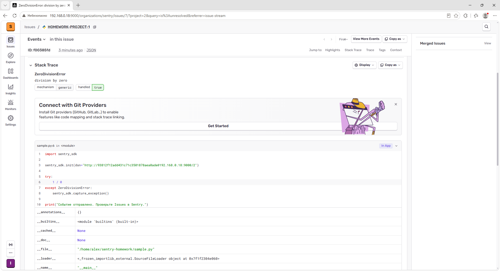
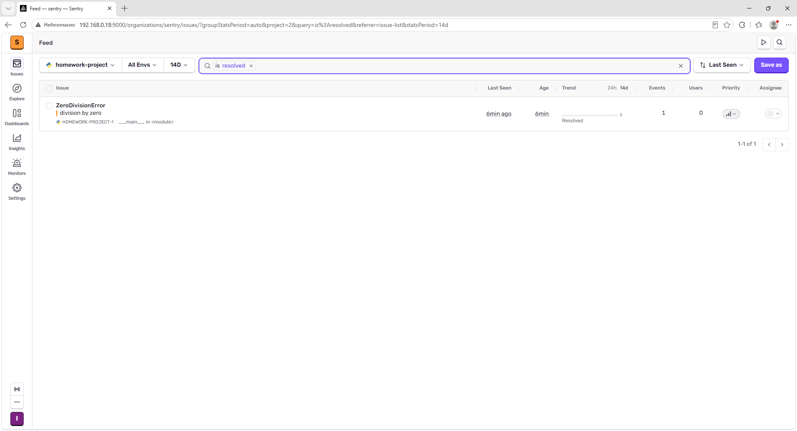
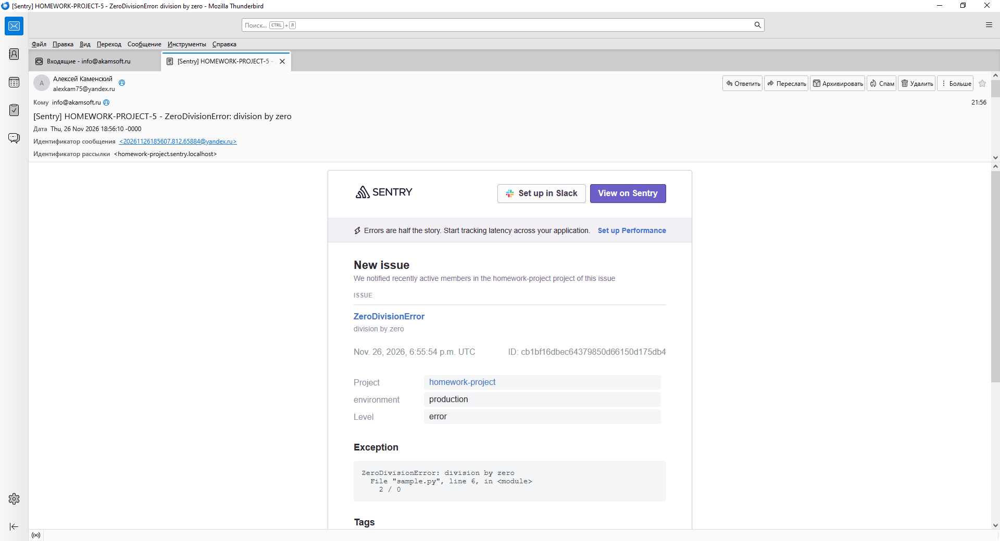
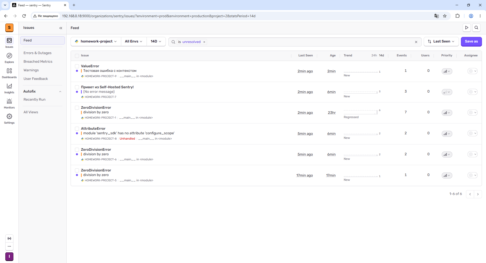
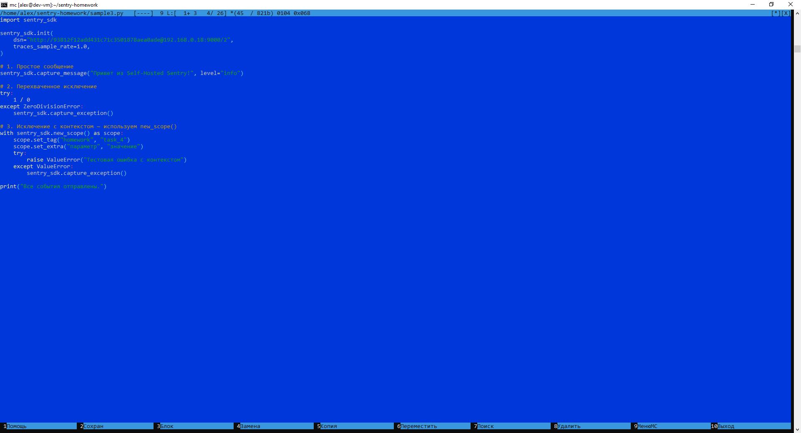

# Домашнее задание к занятию 16 «Платформа мониторинга Sentry»

**Способ развертывания:** Self-Hosted Sentry, версия **26.10.1** на виртуальной машине (Proxmox VE)
**Конфигурация VM:** 4 vCPU, 32 ГБ RAM, 132 ГБ SSD
**ОС:** Debian 13 (trixie)

---

## Задание 1. Меню Projects

Так как Self-Hosted Sentry довольно требовательная к ресурсам система, мы будем использовать Free Сloud account.

Free Cloud account имеет ограничения:

- 5 000 errors;
- 10 000 transactions;
- 1 GB attachments.

Для подключения Free Cloud account:

- зайдите на sentry.io;
- нажмите «Try for free»;
- используйте авторизацию через ваш GitHub-аккаунт;
- далее следуйте инструкциям.

В качестве решения задания пришлите скриншот меню Projects.

Sentry развёрнут по официальной инструкции из репозитория [getsentry/self-hosted](https://github.com/getsentry/self-hosted) (тег `26.10.1`). После входа в систему открыто меню **Projects**.



---

## Задание 2. Sample Event, Stack Trace и Resolved

1. Создайте python-проект и нажмите `Generate sample event` для генерации тестового события.
2. Изучите информацию, представленную в событии.
3. Перейдите в список событий проекта, выберите созданное вами и нажмите `Resolved`.
4. В качестве решения задание предоставьте скриншот `Stack trace` из этого события и список событий проекта после нажатия `Resolved`.

Создан Python-проект `homework-project`. С помощью официального SDK `sentry-sdk` сгенерировано исключение `ZeroDivisionError`. В событии открыт раздел **Stack Trace** с полной трассировкой стека.

**Код скрипта `sample2.py`:**

```
import sentry_sdk

sentry_sdk.init(dsn="http://93812f12add431c71c3501878aea0ade@192.168.0.18:9000/2")

try:
    1 / 0
except ZeroDivisionError:
    sentry_sdk.capture_exception()

print("Событие отправлено. Проверьте Issues в Sentry.")
```

**Stack Trace события:**



После изучения событие переведено в статус **Resolved** через список Issues.

**Список Issues после нажатия Resolved:**



---

## Задание 3. Алёртинг и email-уведомление

1. Перейдите в создание правил алёртинга.
2. Выберите проект и создайте дефолтное правило алёртинга без настройки полей.
3. Снова сгенерируйте событие `Generate sample event`.
Если всё было выполнено правильно — через некоторое время вам на почту, привязанную к GitHub-аккаунту, придёт оповещение о произошедшем событии.
4. Если сообщение не пришло — проверьте настройки аккаунта Sentry (например, привязанную почту), что у вас не было 
`sample issue` до того, как вы его сгенерировали, и то, что правило алёртинга выставлено по дефолту (во всех полях all).
Также проверьте проект, в котором вы создаёте событие — возможно алёрт привязан к другому.
5. В качестве решения задания пришлите скриншот тела сообщения из оповещения на почте.
6. Дополнительно поэкспериментируйте с правилами алёртинга. Выбирайте разные условия отправки и создавайте sample events. 

Создано правило алёртинга:

- **Триггер:** A new issue is created (создание нового issue).
- **Условия:** все фильтры в положении **All** (без дополнительной настройки).
- **Действие:** отправка email на адрес `i---@a------t.ru`.

Для реальной доставки почты настроен внешний SMTP-сервер **Яндекс.Почта**:

- **SMTP host:** `smtp.yandex.ru`
- **Порт:** `465` (SSL)
- **Аутентификация:** логин — полный адрес ящика, пароль — пароль приложения (создан в Яндекс ID).
- **Параметры в `sentry/config.yml` и `sentry/sentry.conf.py`:** `mail.from` совпадает с `mail.username` (требование Яндекса).

После повторной генерации события через SDK письмо успешно доставлено на `i---@a------t.ru`.

**Тело полученного письма из оповещения:**



---

## Задание повышенной сложности

1. Создайте проект на ЯП Python или GO (около 10–20 строк), подключите к нему sentry SDK и отправьте несколько тестовых событий.
2. Поэкспериментируйте с различными передаваемыми параметрами, но помните об ограничениях Free учётной записи Cloud Sentry.
3. В качестве решения задания пришлите скриншот меню issues вашего проекта и пример кода подключения sentry sdk/отсылки событий.

К Python-скрипту подключён Sentry SDK (`sentry-sdk` 2.x). Отправлены три типа событий:

1. **Простое сообщение** через `sentry_sdk.capture_message()`.
2. **Перехваченное исключение** через `sentry_sdk.capture_exception()` (`ZeroDivisionError`).
3. **Исключение с дополнительным контекстом** — теги (`homework: task_4`) и extra-параметр, заданные через `sentry_sdk.new_scope()` (в SDK 2.x `configure_scope()` и `push_scope()` удалены, вместо них используются `new_scope()` / `isolation_scope()`).

**Список Issues с событиями, отправленными из SDK:**



**Код скрипта `sample3.py`:**



---
